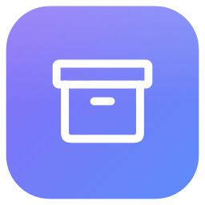
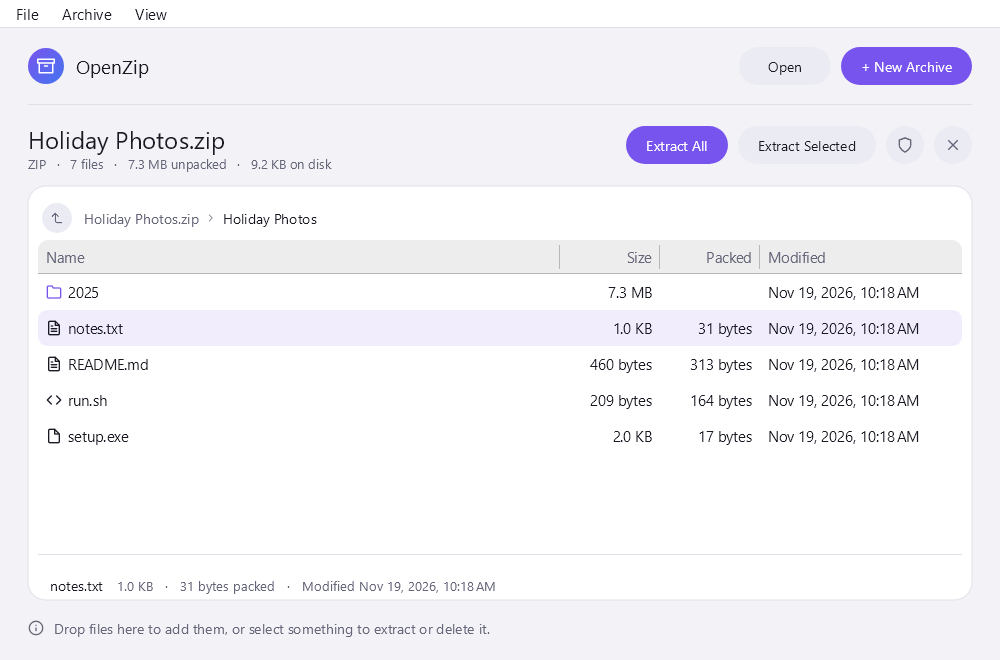
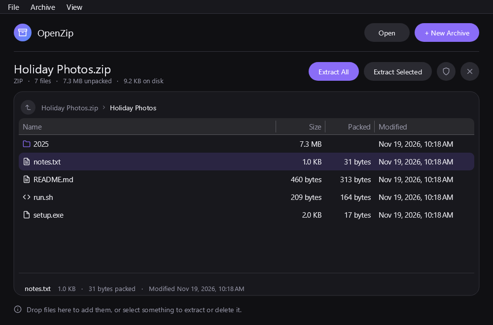
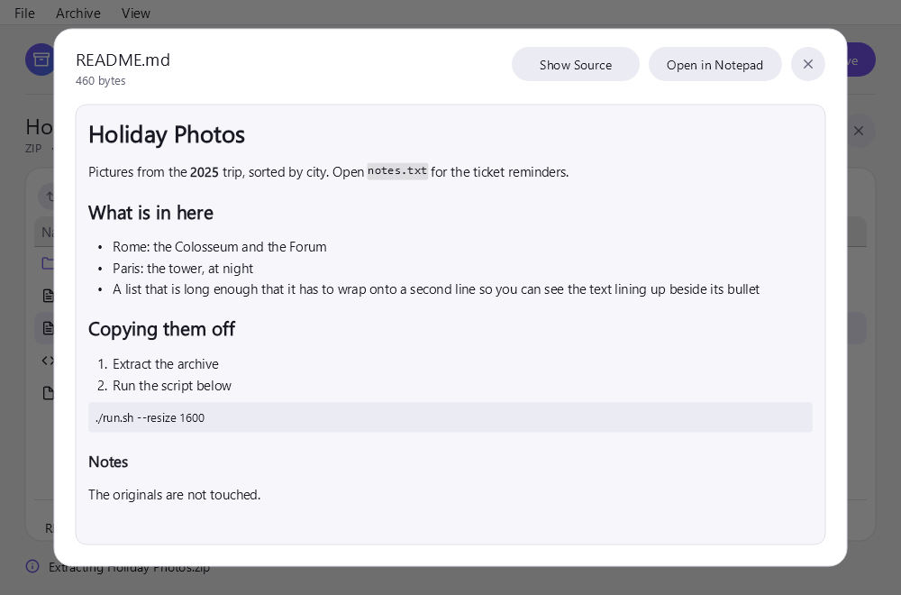
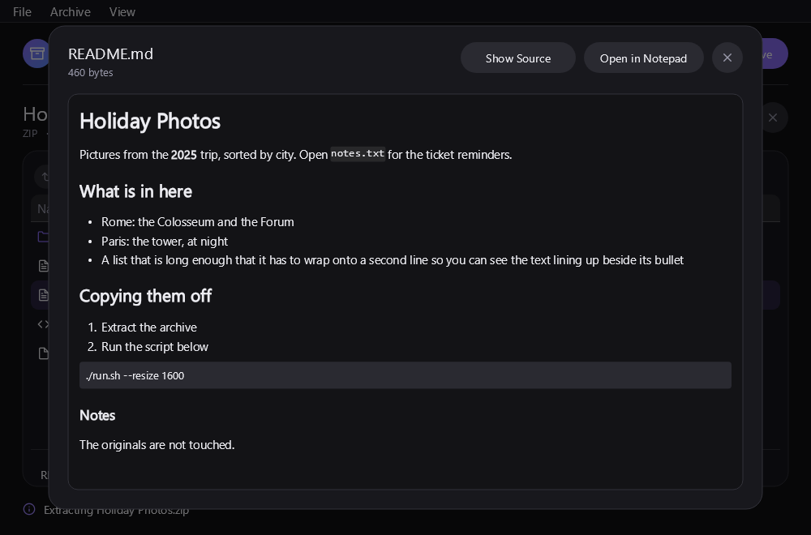

<p align="center">
  
</p>

<h1 align="center">OpenZip</h1>

<p align="center">
  <b>A free archive utility for macOS, Windows and Linux.</b><br>
  Open anything, zip everything, and never pay for a zipping app again.
</p>

<p align="center">
  Java 25 &nbsp;·&nbsp; built on <a href="https://github.com/piitex/RenGL">RenGL</a> &nbsp;·&nbsp; light and dark
</p>

<p align="center">
  
  
</p>

<p align="center">
  
  
</p>

---

macOS has no good free zipping app that isn't asking for money. OpenZip is one: small, quick, safe with archives you
didn't make, and the same on every system.

## Download

Grab the build for your system from the [latest release](https://github.com/piitex/OpenZip/releases/latest).

| System | File |
|---|---|
| **Windows** (x64) | `OpenZip-<version>-windows-x64-setup.exe` |
| **macOS** (Apple silicon or Intel) | `OpenZip-<version>-macos-arm64.tar.gz` or `macos-x64.tar.gz`: unpack it and drag `OpenZip.app` to Applications |
| **Linux** (x64 or arm64) | `OpenZip-<version>-linux-<cpu>.deb` or `.rpm` |

The builds aren't signed yet, so Windows SmartScreen and macOS Gatekeeper will warn the first time (on a Mac,
right-click the app and choose *Open*). The Linux packages haven't been run yet.

## What it does

| | |
|---|---|
| **Create** | `.zip` `.7z` `.tar.gz` `.tar.xz` `.tar.bz2` `.tar`, with the compression level you choose |
| **Open and extract** | all of the above, plus `.rar` (RAR 3, 4 and 5, solid, encrypted, `.cbr` comics) and single files like `access.log.gz` |
| **Protect** | AES-256 passwords on zip and 7z; password-protected zip, 7z and RAR open too |
| **Browse** | one folder at a time with a path bar and sortable Name, Size, Packed and Modified columns |
| **Select** | click, Shift/Ctrl-click, or **drag a box** around rows like on the desktop |
| **Preview** | press **Space** to read a file without extracting it: Markdown as a document, code with syntax colors |
| **Edit in place** | drop files onto an open zip or tar to add them, or press **Delete** to remove entries |
| **Test** | read every file and check its checksum |

A few details that make the difference:

- **Drag out.** On Windows, drag files from an archive straight onto Explorer or the desktop. They extract in the
  background while you drag, with progress and Cancel.
- **Right-click anywhere.** Windows Explorer gets *Open with OpenZip*, *Compress to ZIP* and *Compress with OpenZip...*.
  macOS gets *Compress with OpenZip* in Finder's Quick Actions.
- **Safe by default.** An archive is untrusted input. Names that climb out of the destination (`../`, absolute paths),
  links that point outside it, and Windows tricks like `NUL` or `file.txt:stream` are refused and reported.
- **Never half-done.** A failed or cancelled job leaves no partial archive and never touches your original.
- **Made for Macs.** `.DS_Store`, `._*` and `__MACOSX` clutter stays out of what you make and what you extract.
  Permissions, the executable bit and symlinks survive. Archives from Finder, `zip` and `tar` open here, and ours open
  in `unzip`, `tar` and `ditto`.

## Try it

You need JDK 25+ and [RenGL](https://github.com/piitex/RenGL) installed to your local Maven repository: clone it next
to this folder and run `./mvnw install -DskipTests` there.

```bash
./mvnw compile exec:exec
```

Run the tests with `./mvnw test`. On Windows use `mvnw.cmd` in PowerShell, or `./mvnw` in Git Bash.

## Build the app

RenGL's packager builds Windows, Linux and macOS apps from one computer. The settings (name, icons, file types, the
Explorer right-click entries) live in `rengl-package.properties`.

```powershell
.\package.cmd                                  # every platform
.\package.cmd -Platform windows-x64 -Installer plain   # a Windows setup.exe
.\package.cmd -Platform linux-x64              # one platform
```

Results land in `dist/app-images/`. `package.cmd` looks for RenGL in `..\RenGL`; if it is elsewhere, set `RENGL_HOME`
first. The first all-platform build needs RenGL's `install-natives.ps1` run once. See RenGL's
`docs/reference/packaging.md` for the rest.

## How it's organised

| Package | What is in it |
|---|---|
| `me.piitex.openzip.archive` | The library: reading, writing, safety checks, progress and cancel. No UI, fully unit-tested. |
| `me.piitex.openzip.ui` | The RenGL window: the archive table, path bar, status line and dialogs, with a light and a dark `Palette`. |
| `packaging/` | The icons and the macOS document types that `rengl-package.properties` points at. |

Encrypted zips use [zip4j](https://github.com/srikanth-lingala/zip4j) and RAR uses
[7-Zip-JBinding](https://sevenzipjbind.sourceforge.net/), which is 7-Zip's own code, so RAR 5 works.

## Where things stand

| Platform | Status |
|---|---|
| **Windows (x64)** | Builds, passes its tests, and was run through the packager's `setup.exe`, the right-click entries and the progress window. The installer is unsigned, so SmartScreen warns. |
| **macOS** | Works: the packager builds the `.app` and it runs. It is not signed or notarized, so Gatekeeper warns. Dragging rows out to Finder isn't possible yet (RenGL starts system drags on Windows only). |
| **Linux** | Written from the platform's documentation but not run yet. |

**On the list**

- Searching inside an archive, across every folder.
- Bold, italic, links and tables in the Markdown preview (they show as plain text for now).
- An *Add* button and menu item (adding only works by dropping), and renaming or moving entries.
- Adding to or deleting from 7z, RAR and password-protected zips.
- Multi-volume RAR sets (`.part1.rar`, `.r00`) and creating RAR at all: only RARLAB's software may write it.
- Remembering sort order and column widths between launches.
- Dock and taskbar progress and a "done" notification.

`src/test/.../ui/Screenshot.java` renders the real window to a PNG, for checking the layout without clicking through it.

## License

OpenZip is released under the [Apache License 2.0](LICENSE). Copyright 2026 piitex.

It bundles [zip4j](https://github.com/srikanth-lingala/zip4j) (Apache 2.0), Apache Commons Compress and XZ for Java, and
[7-Zip-JBinding](https://sevenzipjbind.sourceforge.net/) (LGPL 2.1 with the unRAR restriction), each under its own license.
